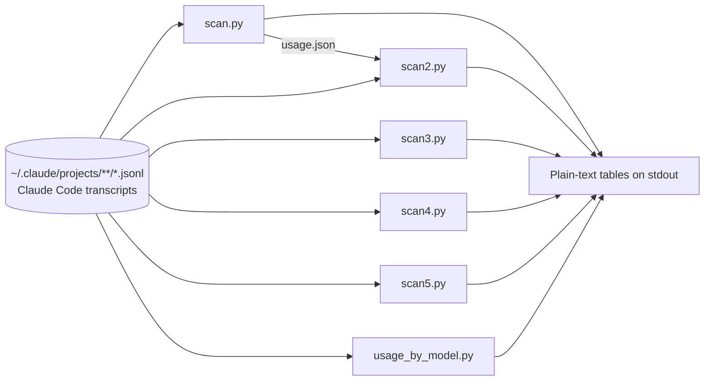

# claude-code-token-scan

Read-only Python scripts that scan Claude Code session transcripts and report where the tokens went: by project, model, day, session and tool.

## Why it exists

Claude Code's usage meter shows a total, not a cause. When a week's usage runs out early, the useful questions are which projects, sessions and habits spent it: large tool results, screenshots that stay in context, side sessions that each pay a fresh startup cost, re-reading long handoff notes, cache rewrites after idle gaps. Claude Code already writes every API call's token usage into its local JSONL transcripts. These scripts aggregate that record so usage decisions can rest on numbers instead of guesses.

They were written for a one-off weekly spend review and kept as reusable tools.

## How it works



Every script walks all `*.jsonl` files under the transcript directory (subagent transcripts included), skips files last modified before the window, and keeps only lines whose timestamp falls inside it.

## Features

| Script | Reports |
|---|---|
| `scan.py` | Totals by project, model, day and lane (main vs subagent); context-size buckets; tool-call counts. Writes a JSON summary used by `scan2.py`. |
| `scan2.py` | Tool-result bytes and images by tool; compactions; calls per user turn; the 30 heaviest sessions with their first prompt. |
| `scan3.py` | Cache-write tokens by cause (session start, after compaction, idle gap over 60 minutes, other); image exposure; Read and Bash output volume; sessions started by the user vs. by another session; session-size buckets. |
| `scan4.py` | Usage by session kind (user, side session, continued chat, subagent); `start_session` initiation; Agent spawns by type and model; output composition (text, thinking, tool input). |
| `scan5.py` | Bytes spent re-reading `HANDOFF` / `START-HERE` / `TRAPS` notes and old transcripts. |
| `usage_by_model.py` | Calls, input, cache write, cache read and output by model since a start time, with by-day and by-project breakdowns. |

## Design decisions

- **One weighted number.** Raw token counts mix very different costs. Each call gets a weight `W = input + 1.25 x cache_write + 0.1 x cache_read + 5 x output`, which follows API-style price ratios (`usage_by_model.py` calls the same number "units"). This is a comparison yardstick, not a bill; how a subscription meter weights tokens is not published.
- **Deduplicate by message.** A streamed assistant message can appear on several transcript lines with the same usage block. `scan.py` keys on message id plus output tokens, `usage_by_model.py` on message id plus request id, so a call is counted once.
- **Separate passes, not one framework.** Each script answers one question and prints a table. They are short and independent so a new question means a new small pass, not a refactor.
- **Read-only, standard library only.** Nothing is sent anywhere. The scripts can be run with `python3 -I` (isolated mode), which is why the configuration block is repeated in each script rather than imported from a shared module.
- **Heuristics are explicit.** Session kinds are detected from the first user message's wording (for example the text Claude Code puts at the top of a session started from another session). `scan3.py` estimates the fixed per-call context "floor" with `SCAN_FLOOR_TOKENS` (default 83,000), a value measured on one machine; set your own.

## Quick start

Requirements: Python 3.9 or newer. No third-party packages.

```bash
git clone <this repo> && cd claude-code-token-scan

# Pass 1 writes the JSON summary that pass 2 reads
python3 -I scan.py --start 2026-01-05 --end 2026-01-12 usage.json
python3 -I scan2.py --start 2026-01-05 --end 2026-01-12 usage.json
python3 -I scan3.py --start 2026-01-05 --end 2026-01-12
python3 -I scan4.py --start 2026-01-05 --end 2026-01-12
python3 -I scan5.py --start 2026-01-05 --end 2026-01-12

# Usage by model since a point in time (for example your weekly reset)
python3 -I usage_by_model.py 2026-01-05T18:00:00Z
```

Configuration, in priority order: command-line flag, then environment variable, then default.

| Setting | Flag | Env var | Default |
|---|---|---|---|
| Transcript directory | `--root` | `CLAUDE_PROJECTS_DIR` | `~/.claude/projects` |
| First day (inclusive) | `--start` | `SCAN_START` | 7 days ago |
| End day (exclusive) | `--end` | `SCAN_END` | tomorrow |
| Summary file for `scan2.py` | positional | `SCAN_USAGE_JSON` | `usage.json` |
| Context floor for `scan3.py` | none | `SCAN_FLOOR_TOKENS` | `83000` |

`usage_by_model.py` takes an ISO start time as its positional argument (default: 7 days ago) and `--root`.

Over a week of heavy use, pass 1 took about a minute.

### Output shape

Illustrative only; the numbers are made up.

```
since 2026-01-05T18:00:00Z: 120 transcript files, 10000 model calls
model                      calls   input  cache-write  cache-read   output   units(M)  share
model-a                     6000    1.0M       20.0M      400.0M     2.0M      76.0  60.0%
model-b                     4000    1.0M       10.0M      300.0M     1.0M      48.5  40.0%
```

## Project structure

```
claude-code-token-scan/
├── scan.py            pass 1: totals by project/model/day/lane, tool calls; writes usage.json
├── scan2.py           pass 2: tool-result bytes, images, compactions, heaviest sessions
├── scan3.py           pass 3: cache-write causes, image exposure, session-size buckets
├── scan4.py           pass 4: session kinds, session starts, agent spawns, output mix
├── scan5.py           pass 5: handoff-note and old-transcript re-read volume
└── usage_by_model.py  usage by model since a start time, by day and by project
```

## Status and limits

- **Working; used for a real review.** Built 2026-11-01 for a weekly usage review; `usage_by_model.py` was added later for checks against a weekly reset.
- The transcript format is Claude Code's internal JSONL, which is not a documented API and can change between versions. Field names used here (`usage`, `cache_creation_input_tokens`, `isSidechain`, `toolUseResult` and so on) matched the version in use in late 2026.
- Session-kind detection relies on wording in Claude Code's own messages and will drift if that wording changes.
- `scan2.py` stops with a `StatisticsError` if the window contains no completed user turns.
- No automated tests. The public copy was checked on a small synthetic transcript, not on real data.

## How this was built

Ryan Wisth built these by directing an AI coding agent (Claude Code). He set the questions each pass had to answer and the weighting, checked the output, and used the results to change how he runs agents. The agent wrote the code.

## License

MIT, see [LICENSE](LICENSE). Not affiliated with or endorsed by Anthropic. Claude and Claude Code are trademarks of Anthropic.
